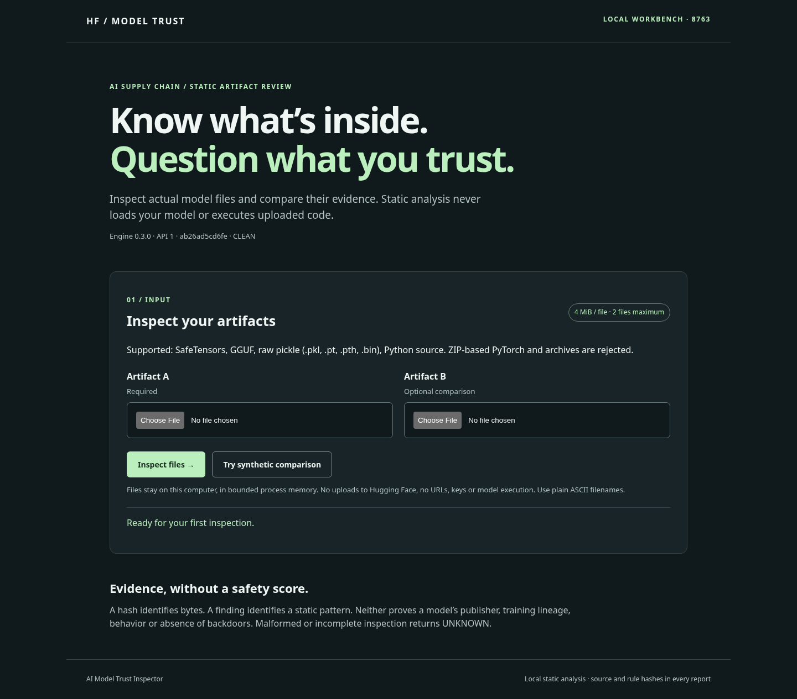

# AI Model Trust Inspector

Inspect and compare actual local model artifacts without loading a model. An ML engineer or supply-chain reviewer supplies one or two authorized files; the browser invokes this repository's static Python, pickle-opcode, SafeTensors and GGUF analyzers in a bounded Linux worker, then shows hashes, structures, findings and unknowns. Software version is **0.3.0**.

**Release decision: PARTIAL.** The supported local workflow functions. A static result does not establish a trusted publisher, training lineage, behavioral safety or absence of backdoors. Independent closing security review remains **BLOCKED**; no current independent PASS is claimed. [Evidence and release limits](docs/EVIDENCE.md) identify exactly what was tested.

## Try the real engine in your browser

[**Open the free Colab notebook**](https://colab.research.google.com/github/poojakira/hf-model-provenance-scanner/blob/codex/local-workbench-20261116/notebooks/try_product.ipynb) · [Inspect the notebook source](notebooks/try_product.ipynb) · [Detailed architecture diagrams](docs/ARCHITECTURE.md)

Sign in with a Google account, select the **free CPU runtime**, and run the setup and scenario cells. Change the scenario and run again to inspect freshly computed evidence and hashes. This is an inline, guided synthetic-data demonstration of the actual repository engine, **not a publicly hosted copy of the full web application**. No API key, paid plan, GPU, Drive mount, tunnel or cloud-resource creation is used by the notebook. Free Colab availability/limits are outside this repository's control.

The setup resolves the reviewed branch to one exact SHA, checks it out and installs only minimal demo dependencies in a separate temporary environment. It starts no web server. [Testing access and limitations](docs/TRY_IT.md) distinguishes locally executed notebook checks from Colab-hosted runtime verification. Use the full local UI below for its broader supported input and workflow.

## Architecture

[](docs/architecture/overview.svg)

Open the [full-size overview](docs/architecture/overview.svg) or [zoomable HTML viewer](docs/index.html). See the [detailed architecture and execution sequences](docs/ARCHITECTURE.md) for exact code symbols, controls, limits, errors, cleanup, evidence and the separate guided notebook scope.

## Start locally

Prerequisites: Linux, Python 3.10 or newer, pip, `libseccomp.so.2`, and a browser. Initial installation may download pinned packages. No provider credentials, model account or paid service is required. From the reviewed checkout:

```sh
python3 -m venv .venv
.venv/bin/python -m pip install -r requirements-local.lock
.venv/bin/python -m pip install --no-deps -e .
.venv/bin/python -m scanner.workbench.server
```

Open **http://127.0.0.1:8763**. For an occupied port, run `.venv/bin/python -m scanner.workbench.server --port 8765` and open the printed address. The bind address stays IPv4 loopback; do not expose it through a tunnel or reverse proxy. Stop with Ctrl-C. An installed package also provides `hf-inspector`; the CLI is `hf-scanner` or `python -m scanner.cli`.

## Complete a real inspection

1. Select **Artifact A** and optionally **Artifact B**, then choose **Inspect files**. Use authorized files with plain ASCII basenames, no directories, 1 byte–4 MiB per file.
2. Read the status, actual SHA-256, findings and evidence. Expand static structures for offsets, descriptors or source locations. **Try synthetic comparison** runs clearly labeled source bytes through the same real worker.
3. Replace a selection and inspect again. Comparison covers hashes/metadata/serialized structures; it does not prove semantic or behavioral equivalence.
4. Choose **Download report + manifest**. The checksum binds the report bytes, not an independent signature or attestation. Selection changes and new scans invalidate obsolete output/downloads.
5. Stop the server with Ctrl-C. Backend input bytes are processed in bounded memory, not extracted or saved. Explicit downloads and original source files remain on the operator's filesystem.

Supported local inputs are SafeTensors, GGUF metadata/descriptors, raw pickle (`.pkl`, `.pickle`, `.pt`, `.pth`, `.bin`, `.ckpt`, `.joblib`) and UTF-8 `.py`. ZIP-based PyTorch checkpoints, archives/compression, ONNX and Keras are not supported by this workbench. Conservative size/dtype/structure limits reject some legitimate artifacts.

| Result | Meaning |
|---|---|
| `CONCERNS` | Configured static patterns matched; investigate their evidence and context. |
| `NO_PATTERN_FOUND` | No configured pattern matched within supported inspection; safety and origin remain unknown. |
| `UNKNOWN` | Unsupported, malformed, failed, timed-out or incomplete inspection; never a clean result. |

GGUF tensor payload layout/quantization is **NOT VERIFIED**. The Linux worker installs a fail-closed seccomp allowlist, no_new_privs, CPU/address-space limits and bounded parent pipes/deadline. This is not a VM, authenticated multi-user service or protection against kernel/library flaws. Same-account local processes and browser extensions remain trusted boundaries. See the [complete limits and lifecycle](docs/INSPECTOR.md).



## Verification and release scope

**LOCAL ONLY, historical snapshot.** The archived suite at `ab26ad5cd6fe28ae1b0986e20da46be9ebb2f27a` recorded 317 passed, 0 failed, 3 skipped, 76.08% statement coverage, and 6 separately counted passing subtests. The archive was generated on November 19, 2026 UTC and lists the exact commands, tooling, test window, skips and artifact hashes. Use its source SHA when citing the results. [Manifest](https://raw.githubusercontent.com/poojakira/hf-model-provenance-scanner/ed25d66b72e374f86e2975930b0ed83b9acf3c09/release-evidence/manifest.json) · [Assessment](https://github.com/poojakira/hf-model-provenance-scanner/blob/ed25d66b72e374f86e2975930b0ed83b9acf3c09/release-evidence/RELEASE_ASSESSMENT.md)

The candidate inspects supported artifact bytes in a bounded worker. Unknown or incomplete results require review. Publisher identity, lineage, behavioral safety and independent security closure remain unverified. [Draft review](https://github.com/poojakira/hf-model-provenance-scanner/pull/103)

## Distinct interfaces and documentation

The local API schema is **1**. The separate authenticated remote admission API in `scanner/service.py` declares **1.0.0**; that is not the software version. It accepts repository IDs and may use configured HF credentials. The local upload UI never calls it or weakens its authentication. Existing dashboards are synthetic/historical visualization assets, not this live inspector.

| Task | Guide |
|---|---|
| First inspection and troubleshooting | [Getting started](GETTING_STARTED.md) |
| Product, architecture, trust boundaries and browser/API lifecycle | [Inspector guide](docs/INSPECTOR.md) |
| CLI, optional repository collection, state and rollback | [Runbook](RUNBOOK.md) |
| Local/remote API and report contracts | [API reference](docs/API_VERSIONING.md) |
| Tests, dependencies, skips and reproducibility | [Testing](docs/TESTING.md) |
| Security reporting, autopsy and unsupported features | [Security](SECURITY.md), [limitations](LIMITATIONS.md) |
| Optional integration and signing boundaries | [Integration](INTEGRATION.md), [signing](docs/supply-chain/SIGNING.md) |
| Evidence, branch/release state and documentation audit | [Evidence](docs/EVIDENCE.md), [audit ledger](docs/DOCUMENTATION_AUDIT.md), [release gates](PRODUCTION.md) |
| Contribution terms and changes | [Contributing](CONTRIBUTING.md), [changelog](CHANGELOG.md) |

Historical reports retain their cited source/date. Curated fixtures are not field accuracy or a population false-positive estimate. No default merge, public deployment or software release is implied by this documentation pass.

## Selected branches and recovery

Only `main` and `codex/local-workbench-20261116` remain as remote branches. This cleanup retired 5 additional branches after preserving their exact tips in `archive/selected-20261118/*` annotated recovery tags and a verified private Git bundle. Unmerged/dependency changes were **not merged or certified** by retiring their branches. Existing release/deployment source references are preserved separately. Main was not rewritten or merged.

See [branch policy and restore procedure](docs/BRANCHES.md) and the generated [branch-cleanup evidence](https://github.com/poojakira/hf-model-provenance-scanner/tree/evidence/selected-branches-20261118/release-evidence/branch-cleanup.json). Bots or collaborators may create later branches; the published report records the actual verification time rather than promising permanent branch counts.
