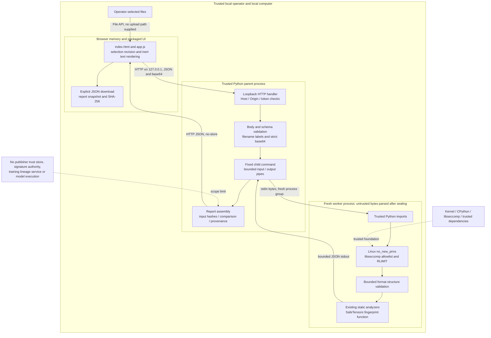
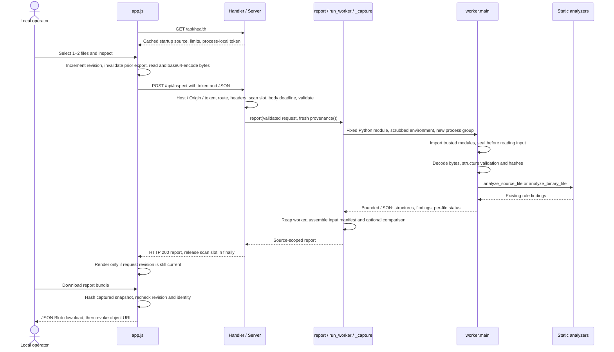
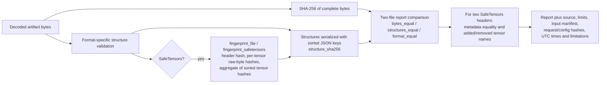
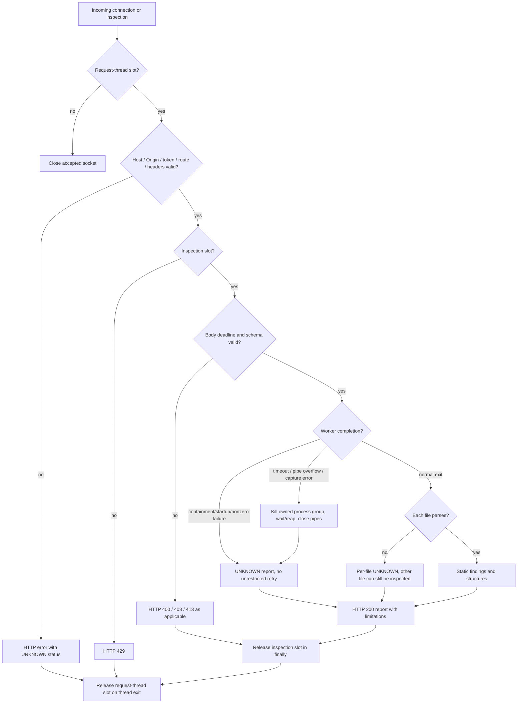
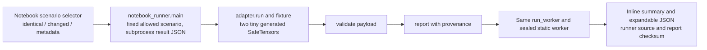

# AI Model Trust Inspector architecture

This document describes the implemented local inspector, software version 0.3.0 and report schema 1. It maps the source paths and symbols below to the actual data flow. The separate remote admission API version 1.0.0, general scanner CLI and historical dashboards have different contracts; they are not components of the local inspection request. See [the inspector guide](INSPECTOR.md) for usage and [the runbook](../RUNBOOK.md) for those other surfaces.

The product inspects one or two small, authorized artifacts as bytes. It does not load a model, deserialize pickle objects, execute uploaded Python, extract archives, fetch model repositories or establish a publisher's identity. A completed inspection is static evidence under configured rules, not approval to run a model.

## Components and trust boundaries

The browser and server run with the operator's local authority. Loopback binding and request controls reduce cross-site access; they are not multi-user authentication. The worker is the boundary around artifact parsing. Trusted interpreter startup and module imports occur before its syscall filter, while the parent wall deadline covers the child interaction. The parent itself is not syscall-contained.

The child imports repository analyzers, then `seal()` installs resource limits, `PR_SET_NO_NEW_PRIVS` and a default-EPERM seccomp policy before it reads stdin. Allowed syscalls support memory management, existing descriptors, signals, clocks, synchronization and process exit. Opens, sockets, exec and process creation are not allowed. The worker inherits the pipe descriptors; this policy does not make all existing-descriptor I/O impossible. A missing library or filter-installation failure stops the worker; there is no unrestricted parsing fallback. This is Linux syscall containment, not a VM, container, kernel exploit defense or arbitrary-code execution service.

## Request and worker lifecycle

`main()` binds only `127.0.0.1`, normally port 8763; `--port` changes the port. The exact Host allowlist contains `127.0.0.1:<port>` and `localhost:<port>`. POST separately permits the corresponding two HTTP Origin values and requires a constant-time token comparison. This is an allowlist of local origins, not a requirement that the Origin string equal the Host string. There is no CORS enablement, remote URL input or arbitrary filesystem path endpoint.

The health token remains in browser memory and is used as a request header. It is not an account credential, authorization between local users or proof of containment. Health readiness does not exercise the worker. Saved health evidence must select non-secret fields explicitly and omit `csrf_token`; do not persist the raw response in logs, screenshots or HAR files.

The parent starts `[sys.executable, "-m", "scanner.workbench.worker"]` without a shell, in the repository/package root. Only `PATH=os.defpath`, `PYTHONDONTWRITEBYTECODE=1` and `PYTHONUTF8=1` are supplied as environment variables. `_capture()` uses nonblocking selectors to write stdin while draining stdout/stderr; it closes stdin after writing and waits for process exit. Artifact names cannot select this command or its working directory.

## Enforced limits and format distinctions

| Boundary | Implemented limit or behavior |
|---|---|
| HTTP concurrency | Eight admitted request threads; one inspection slot; listen backlog 8 |
| Connection/upload time | Socket timeout 5 seconds; body read also has a total 5-second deadline |
| HTTP body | One numeric Content-Length, 1 byte–12 MiB; no Transfer-Encoding; exact `application/json` media type |
| Schema | Only `files`; 1–2 objects containing exactly `name` and `data` |
| Filename | ASCII basename matching `[A-Za-z0-9][A-Za-z0-9_.-]{0,119}`; a label, never an opened path |
| Artifact | Strict base64; decoded size 1 byte–4 MiB per file; browser also checks size |
| Worker | Parent deadline 8 seconds; CPU 4 seconds; address space 384 MiB |
| Additional RLIMIT | File size 0; core size 0; open descriptor limit 32 |
| Pipes | stdout 4 MiB; stderr 64 KiB; input/output serviced in chunks up to 64 KiB |
| Worker serialization | Encoded result over 4 MiB replaced with an UNKNOWN error result |
| Structure collections | Typically 4096 entries/opcodes/nodes; format-specific limits below |

These bounds belong to this local adapter. They are not the general CLI's 100 MiB binary limit or a large-model processing promise. Response-byte limits apply to worker output; the parent adds report metadata and hashes afterward.

The extension selects a format validator, then actual bytes must satisfy that validator. Any `PK` prefix is rejected before dispatch, including renamed ZIP/PyTorch containers. There is no archive extraction or decompression.

| Local format | Structure validated before canonical analysis | Remaining boundary |
|---|---|---|
| `.safetensors` | 8-byte length prefix; 2-byte–1 MiB strict JSON header; no duplicate keys/non-finite values; map at most 4096 entries; string metadata values; supported dtype; at most 32 dimensions; dimension/product bounds; exact shape-to-byte ranges; contiguous nonoverlapping payload with no unreferenced trailing bytes | Conservative subset; unsupported dtypes or legitimate larger artifacts are rejected. Valid structure does not establish safe model behavior. |
| `.gguf` | Magic; version 2/3; at most 4096 metadata entries and tensor descriptors; strict UTF-8 strings up to 1 MiB; bounded non-nested arrays; finite numeric values; descriptor dimensions 1–4 and bounded sizes; bounds and zero-tensor trailing-data checks | Nonzero-tensor payload layout, offsets into the payload and quantization validity are not verified. Existing content rules inspect only their first 100 array elements; recording complete bounded arrays does not extend those rules. |
| `.pkl`, `.pickle`, `.pt`, `.pth`, `.bin`, `.ckpt`, `.joblib` | Raw `pickletools.genops` stream, at most 4096 opcodes, complete STOP and no trailing bytes; opcode offsets, 256-character argument previews and full argument-representation hashes | Never unpickled. Parseable opcodes do not prove safe loading or framework validity. Protocol-0 pickle has no universal magic. ZIP checkpoints remain unsupported. |
| `.py` | Strict UTF-8, no NUL or selected binary-prefix mismatch; parseable Python AST of at most 4096 nodes; node types/line numbers and source hash | Never imported or executed. Syntactic validity and static rules do not prove behavior. |

`worker.inspect()` calls `structure()` first. Only after validation does it call the existing `scanner.cli.analyze_source_file()` for Python or `analyze_binary_file()` for binary formats. The broader CLI supports other analysis paths; that does not expose ONNX, Keras, shell, remote collection or runtime monitoring through this local UI.

## Fingerprints, comparison and report authority

SafeTensors fingerprinting is real byte hashing, not a model inference. `fingerprint_safetensors()` hashes the original header bytes, individual tensor byte slices and an aggregate formed from sorted tensor hashes joined by newlines. Its aggregate alone does not bind names, order, shape or dtype; the full structures retain descriptors and the full-file hash. The adapter removes the fingerprint's `file_path` label before computing `structure_sha256`, so changing only a filename does not change the structure hash. This local UI does not call the separate `compare_fingerprints()` baseline-finding function.

With two returned file results, `report()` compares full hashes, structure hashes and format labels. Structure/format equality are null when either side lacks those fields. Byte hashes can still be compared for malformed files: equality is a statement about bytes, not successful parsing. Header comparison additionally reports metadata equality and tensor-name additions/removals. There is no tensor semantic equivalence, malicious-change attribution, trusted baseline or authenticated lineage conclusion. Python structures include the source hash, so AST similarity does not make changed source equal.

Per-file status is `CONCERNS` when existing rules return findings, `NO_PATTERN_FOUND` when they return none, or `UNKNOWN` on validation failure. Top-level `STATIC_INSPECTION_ONLY` means no worker/file UNKNOWN was reported; it is also used when findings exist. It is not an aggregate clean or safe verdict. Worker failure or any per-file UNKNOWN makes the top-level assessment UNKNOWN. Rule severity is a rule label, not a measured probability or independently proven exploitability.

`provenance()` accepts Git identity only when the Git top level exactly equals the package root and `scanner/workbench/server.py` is tracked. Otherwise commit and source state are UNKNOWN, including an installed wheel under unrelated Git. It hashes `scanner/**/*.py` and `scanner/data/*.json` into `rule_sources` and `rule_set_sha256`. Health caches startup provenance; each HTTP inspection collects fresh provenance. These are observations of local source files, not signed attestations, complete dependency/runtime measurements or protection against the trusted local account modifying source.

The report records a UUID, start/end UTC, software/schema versions, limits, a hash of the limits dictionary, input names/sizes/hashes, the input-manifest hash and request hash. `config_sha256` covers `LIMITS`, not every interpreter/dependency/environment setting. Hashes bind the recorded representations; they do not authenticate a publisher, signer, timestamp authority or release approval.

## Browser state, export and failure cleanup

Selections and each new inspection increment `revision`; `invalidate()` clears `latest` and hides old output before asynchronous reads or requests. Responses with an obsolete revision cannot become current evidence. Existing requests may continue to completion: revision checks prevent stale display, not server-side cancellation. UI size/read errors leave old export authority invalidated. Report text and findings are built with `textContent`, rather than interpreting artifact strings as HTML.

On download, the browser captures both the report object and revision, serializes that snapshot with `JSON.stringify(report,null,2)` and hashes its UTF-8 bytes without a trailing newline. After the asynchronous digest it checks both revision equality and report-object identity before creating the bundle. The manifest records the hash, run ID and source. A changed selection/new scan cancels obsolete export authority. The Blob URL is revoked after one second. This checksum detects changes to that serialization; it is not a digital signature or external attestation.

HTTP status distinguishes transport/schema problems from delivered analysis. Forbidden requests are 403; unknown routes 404; unsupported content type/transfer encoding 415; invalid length 413; malformed JSON/schema/base64 400; body deadline 408. The one-scan gate returns 429, whereas saturation of the eight-thread gate closes the connection. Per-file parse errors and worker failures are delivered in HTTP 200 reports containing UNKNOWN, not security success. The diagram summarizes control flow; route/auth/header failures occur before inspection-slot acquisition.

`_capture()` kills the child's process group with SIGKILL on capture failure, waits for it and closes pipes/selectors in `finally`. On normal completion it waits for exit. The worker has no persistent input files to remove. Restarting the server creates a new token. Ctrl+C stops the server entry point; this is not a persistent job queue, resumable scan store or production recovery system.

## Privacy and controls that do not exist

Inputs are copied through browser, parent and child memory; no upload temporary files, extraction directories, backend report database, analytics submission or remote model fetch are created by this flow. The server suppresses request logging and sends no-store, nosniff, no-referrer and a restrictive same-origin CSP. Explicit browser downloads persist on the operator's filesystem. Reports can contain filenames, metadata and rule evidence from artifact content; handle exports accordingly. Process-memory reclamation is not cryptographic erasure and does not guarantee that the operating system never swaps memory or that privileged inspection is impossible.

There is no multi-tenant isolation, account/role system, trusted publisher/key registry, signature validation in this upload flow, training-data lineage proof, model inference, dynamic backdoor test, guaranteed malware detection, tamper-evident server ledger or production availability commitment. Same-account processes, browser extensions, trusted dependencies, the interpreter and kernel remain relevant trust assumptions. A full independent closing security review remains **BLOCKED**, as recorded in [EVIDENCE.md](EVIDENCE.md); this architecture document neither retries nor substitutes for it.

## Separate guided notebook path

The [guided notebook](../notebooks/try_product.ipynb) is a separate inline demonstration, not a hosted instance of the local web app. Its setup resolves the selected public branch once, checks out that exact SHA into a temporary directory and installs `demo/requirements-notebook.txt` in a separate temporary Python environment. The intended Colab path uses the free CPU runtime and the user's normal Google sign-in; no provider API key, paid compute, GPU, Google Drive mount, tunnel or application HTTP server is requested. Free-session availability and full Colab-hosted execution are not verified by the existence of this notebook.

`adapter.run()` accepts only the three scenario identifiers, constructs two synthetic one-element F32 tensors and calls the same `validate()` and `report()` functions directly. The scenarios change only filenames, actual weight bytes or metadata. No arbitrary upload, server endpoint or model execution is added. The notebook invokes its fixed runner in a subprocess with a 60-second outer timeout; the inner worker retains its 8-second deadline and fail-closed containment. Its `report_sha256` hashes compact sorted-key JSON with `ensure_ascii=true` and no NaN; this is a different serialization from the browser bundle. An UNKNOWN engine result remains explicitly UNKNOWN. Local cell execution, a future Colab-hosted run and verification of the full browser app are distinct evidence scopes.

## Source map and verification scope

| Responsibility | Source symbols |
|---|---|
| Browser health, encoding, revisions, rendering and export | [app.js](../scanner/workbench/app.js): `encode`, `inspect`, `render`, `invalidate`, form/change/download listeners |
| HTTP binding and admission | [server.py](../scanner/workbench/server.py): `main`, `Server`, `Handler.setup`, `trusted_host`, `do_GET`, `do_POST`, `send` |
| Payload schema and file limits | [server.py](../scanner/workbench/server.py): `MAX_BODY`, `LIMITS`, `validate` |
| Process/pipe lifecycle and report composition | [server.py](../scanner/workbench/server.py): `_capture`, `run_worker`, `report`, `provenance` |
| Actual worker parsing and status | [worker.py](../scanner/workbench/worker.py): `main`, `inspect`, `structure`, `strict_json`, `gguf_string`, `gguf_value`, `digest` |
| Linux containment | [containment.py](../scanner/workbench/containment.py): `seal` |
| Canonical analysis dispatch | [cli.py](../scanner/cli.py): `analyze_source_file`, `analyze_binary_file` |
| Tensor fingerprint computation | [weight_fingerprint.py](../scanner/analyzer/weight_fingerprint.py): `fingerprint_file`, `fingerprint_safetensors`, `_compute_aggregate_hash`, `ModelFingerprint.to_dict`, `DTYPE_SIZES` |
| GGUF content-rule boundary | [gguf_scanner.py](../scanner/analyzer/gguf_scanner.py): `_read_gguf_string`, `_read_gguf_value`, `analyze_gguf_file` |
| Guided synthetic notebook | [adapter.py](../demo/adapter.py): `fixture`, `run`, `SPEC`; [notebook_runner.py](../demo/notebook_runner.py): `source`, `main`; [notebook](../notebooks/try_product.ipynb) setup/scenario cells |

These diagrams document inspected source; they are not freshly executed release evidence. Current commit-specific test, browser, build and hosted-workflow results belong in [EVIDENCE.md](EVIDENCE.md). New documentation or notebook commits must not inherit older-head results as current passes. Independent release readiness, including the blocked closing review, remains separate from architectural completeness.
