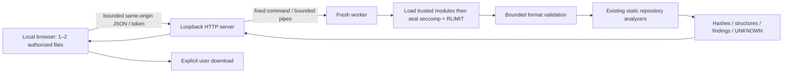

# Local inspector engineering guide

## Product requirements

The user is an ML engineer or supply-chain reviewer assessing one or two authorized local artifacts. The job is to identify file bytes, inspect supported structures, surface existing suspicious-content rules and compare changed evidence without executing a model. The smallest complete journey is launch → select actual files → inspect → review evidence/unknowns → replace an input → inspect again → download the report bundle.

Acceptance requires the actual engine on user-supplied bytes, bounded inputs and worker lifecycle, honest errors, a working comparison, reproducible hashes, accessible desktop/mobile controls, real browser checks and a clean installed-package launch. Source paths are `scanner/workbench/`, `tests/test_workbench.py` and `scripts/workbench_e2e.py`. No publisher authentication, remote repository fetch, training lineage proof, semantic model equivalence, runtime backdoor detection or universal safety score is promised. Those are not implemented in this UI.

## Architecture and decisions

**Frontend/backend:** stdlib HTTP server and packaged HTML/CSS/JavaScript keep the local product independent of remote FastAPI admission. Bind is hardcoded `127.0.0.1`; there is no public-host flag. Host validation rejects DNS-rebinding hostnames. POST requires exact local Origin plus an unpredictable per-process token; CORS is not enabled. Eight connections and one inspection are admitted at once, with a five-second upload deadline.

**Worker lifecycle:** a fixed Python module runs in a fresh process group, with a scrubbed environment and no shell. Trusted modules load before hostile input is read. A Linux libseccomp default-deny syscall allowlist then blocks filesystem opens, networking, exec and child creation. Failure to install containment produces UNKNOWN; no fallback to unrestricted parsing occurs. CPU is limited to four seconds, address space to 384 MiB and parent wall time to eight seconds. Parent reads stdout ≤4 MiB and stderr ≤64 KiB while writing input; overflow/deadline kills and reaps the group. The worker also caps serialization. Kernel isolation is not a VM/container. Bubblewrap/user namespaces were unavailable in the development environment; no container sandbox claim is made.

**Storage/privacy:** uploaded bytes live in bounded browser/server/worker memory. There are no extracted files, uploads, persistent sessions or report history. Filenames are labels, never paths. Input temporary-file cleanup is unnecessary because no input temporary files exist. Process memory is reclaimed, not cryptographically erased. Application logs omit request contents/names/tokens. Closing the tab discards the report; explicit downloads remain under the user’s control.

**Engine authority:** structure validation precedes `scanner.cli.analyze_binary_file` or `analyze_source_file`. Existing analyzers remain the detection source; the frontend has no detection signatures. SafeTensors fingerprints use the repository’s `fingerprint_file`. Pickle uses static `pickletools.genops` plus existing opcode rules, never `pickle.load`, `torch.load` or uploaded imports. GGUF invokes the existing metadata engine after validating bounds/types. The engine examines at most its existing first 100 GGUF array elements; complete array values are recorded for comparison, not a promise of complete content detection.

## Supported formats and boundaries

At most two files; each 1 byte–4 MiB; request ≤12 MiB; plain ASCII basename ≤120 characters. Supported extensions are in the README. No archives or decompression are performed. ZIP magic is rejected even when renamed. Content-type must be application/json and actual format structures must parse; filename/extension alone is never a successful inspection.

SafeTensors: ≤1 MiB header; strict JSON without duplicate keys/non-finite numbers; ≤4096 descriptors; ≤32 dimensions; supported dtype; shape/byte range equality; contiguous nonoverlapping tensor data; no unreferenced trailing bytes. This conservative subset rejects some newer valid dtypes or larger legitimate artifacts.

Pickle: ≤4096 parsed opcodes; complete STOP; no trailing bytes; object offsets and bounded argument previews/full-argument hashes. This validates the parseable opcode stream, not that loading it would be safe or valid for a particular framework. Protocol-0 pickle has no universal magic; static opcode parsing establishes the supported structure. ZIP checkpoint containers are rejected.

GGUF: v2/v3, ≤4096 metadata entries/tensors, strings ≤1 MiB, bounded non-nested arrays, finite numeric metadata, strict UTF-8 and complete metadata/descriptor bounds. Unexplained trailing data is rejected for zero-tensor files. Nonzero-tensor payload layout/quantization is not validated; this limitation is part of the result. Large/quantized production models usually exceed this workbench’s conservative subset.

Python: strict UTF-8, no NUL, parseable AST ≤4096 nodes. Source is parsed and analyzed, never imported/executed. AST comparison includes a source hash; no behavioral equivalence claim is made.

Malformed, unsupported, excessive, crashed or timed-out input returns UNKNOWN. There is no green safety score. Root/source/runtime/config hashes and timestamps qualify every inspection. Installed wheels outside Git report commit/source state UNKNOWN; Git provenance is not invented.

## Browser user guide

1. Start from the README command and open the loopback URL. Version/source state appears above the form.
2. Choose Artifact A, optionally B. Choose Inspect files. Keyboard users can tab through labeled file controls and buttons. Status uses an aria-live region, and results receive focus.
3. Read status, SHA-256 and findings. Expand structures for actual offsets/descriptors. Review limitations even if no configured pattern is found.
4. Replace a file and rerun. Changing a selection invalidates old output. Delayed file reads or responses cannot overwrite a newer selection.
5. Download the JSON bundle. It contains `report` and a `manifest.report_sha256` computed over UTF-8 `JSON.stringify(report,null,2)`, without a trailing newline. The checksum detects accidental modification; it is not a digital signature or trusted third-party attestation.

The synthetic button processes actual synthetic source bytes with the same worker. It is labeled synthetic and cannot be mistaken for field validation. On a size/filename error, rename/reduce the file and retry. On UNKNOWN inspect the error; an invalid header is not a clean result. On worker unavailable, verify Linux/libseccomp prerequisites and restart. Do not enable unrestricted fallback. A busy response is HTTP 429; retry after the current request completes.

## Local API contract (schema version 1)

- `GET /`: workbench HTML; `/app.js` and `/style.css`: packaged assets.
- `GET /api/health`: readiness, engine/software version, local schema version, source commit/CLEAN-DIRTY-UNKNOWN, rule source hashes, configured limits and per-process CSRF token. Readiness alone does not prove the worker can install seccomp.
- `POST /api/inspect`: exact local Origin, `X-Inspector-Token` from health, `Content-Type: application/json`, valid Content-Length, no Transfer-Encoding. Body: `{"files":[{"name":"weights.pkl","data":"gAROLg=="}]}`. This is a synthetic raw pickle example (protocol 4, NONE, STOP).

Response: report schema/run ID/start-end UTC/source provenance/limits/config hash/input manifest and hashes/request hash/assessment/result/comparison/limitations. Each file has name, size, SHA-256 and status. Successfully inspected files add format, structures, structure hash and findings. Unknown files add error. Worker-level failure has `result.error` and empty result files; the input manifest still records all selected hashes. Comparison fields can be null if parsing failed. Finding severity is a rule label, not proven exploitability.

HTTP errors: 400 malformed JSON/schema/filename/base64; 403 origin/token/Host; 404 unknown route; 408 upload deadline; 413 absent/invalid/excessive length; 415 content-type/transfer encoding; 429 one scan already active. Per-file parse/worker failures are successful report delivery (HTTP 200) with UNKNOWN assessment, never successful security validation. Other HTTP methods are unsupported. There is no URL, arbitrary path, command, database or remote-upload endpoint. Remote admission API authentication is unchanged and outside this local API contract.

## Threat model and operational boundaries

Assets: local files/environment/credentials, process availability, report integrity and user interpretation. Adversaries: malicious model producer, malformed input, cross-origin browser site, concurrent local client. Boundaries: browser selection → bounded HTTP parser → fixed child process → sealed static parser → inert text rendering/export. All strings are rendered via textContent; no uploaded HTML is interpreted. CSP permits only same-origin scripts/styles/connect, disallows framing and external resources. Report hashes and input hashes bind evidence; there is no tamper-evident server ledger.

Controls and tests: path names/URLs rejected; byte/time/memory/output/concurrency quotas; no extraction; archive/polyglot/dimension/array tests; real syscall-denial tests; actual flood/timeout/recovery tests; Host/Origin/token checks; stale-selection browser tests. Residual risks: kernel/libseccomp/CPython vulnerabilities; expensive trusted startup before the filter (still wall bounded); same-account local processes/browser extensions; large files/newer formats; incomplete GGUF payload validation; detection false positives/negatives. No multi-user service, public exposure, production approval or cryptographic provenance verification is supported.

## Operations, development and rollback

Default port 8763; only `--port` can change. To stop, Ctrl+C. Workers are disposable, there is no database to back up or migrate. Do not reverse-proxy publicly or disable quotas/containment to inspect a file. Restart clears the local session token. To roll back use the prior reviewed checkout and a separate new virtual environment; existing reports remain self-described. `install.sh` installs only the reviewed local checkout into a new venv and refuses existing paths; it never deletes a target, fetches remote source or edits shell profiles. Requires Python 3.10+.

Run the tests and static tools in [TESTING.md](TESTING.md). Format source with Ruff 0.8.4. Dependency resolution is pinned in requirements-local.lock for reproducible local acceptance; no credentials are needed. The optional ATT&CK package is a distinct integration and is not required by the browser engine. Remote CLI/network operations and production admission remain outside this keyless local acceptance scope.
